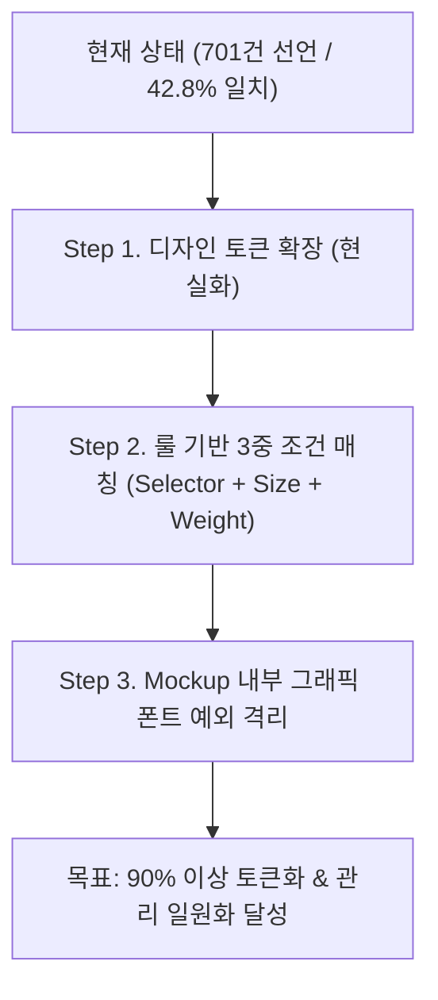
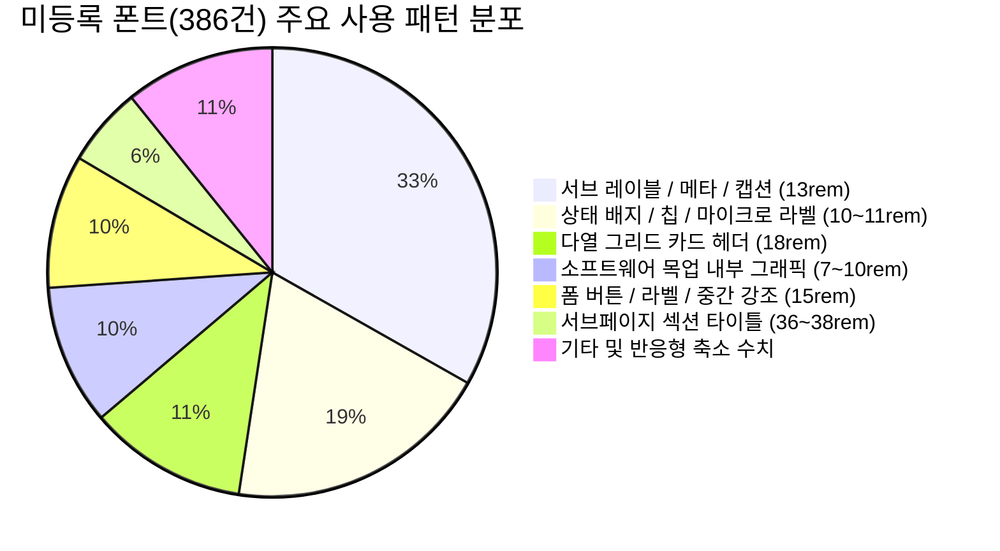

# 📊 xPrivacy 타이포그래피 설계 토큰 vs 실제 UI 퍼블리싱 전수 분석 보고서

본 문서는 **디자인 시스템 파운데이션(타이포그래피)**에 정의된 토큰/믹스인 명세와, 실제 서비스 및 퍼블리싱 페이지(`src/pages/pub/` 및 `src/components/`) 전역에서 사용 중인 폰트 선언 현황을 전수 분석하여 **실제 시맨틱 구조 파악 및 자동 매칭 가능성**을 검토한 기술 분석 보고서입니다.

---

## Executive Summary (핵심 요약)

*   **스캔 대상**: 총 43개 SCSS 모듈 파일 전수 스캔 (퍼블리싱 페이지 및 공통 컴포넌트)
*   **전체 폰트 선언 수**: 총 **701건**
*   **기존 디자인 토큰 일치율**: **42.8% (300건)** / **토큰 외(Out-of-System) 수치**: **57.2% (401건)**
*   **타이포그래피 시스템 본질적 아키텍처 원칙 (Core Architectural Principle)**:
    > **"디자인 시스템의 타이포그래피는 중심이 되는 섹션 단위 [목차(Eyebrow) / 제목(Title) / 본문(Description) / 보조설명(Lead/Caption)] 기준으로 통제되며, 그 밖의 독립적인 UI 가이드(버튼, 뱃지, 탭, 모달, 폼, 데이터 테이블, 목업 그래픽)는 섹션 타이포그래피의 영향을 받지 않고 각 컴포넌트 고유 스펙에 따라 독립적으로 관리된다."**
*   **핵심 발견 사실**:
    1.  **적용 영역의 명확한 분리**: `13rem`(128건), `11rem`(45건), `15rem`(37건), `10rem`(29건) 등은 '시스템 결함'이 아니라, **섹션 타이포그래피 관할 밖의 독립적인 UI 컴포넌트(GNB 링크, 뱃지, 탭 버튼, 폼 라벨, 목업 그래픽)에서 사용되는 고유 컴팩트 스펙**입니다.
    2.  **섹션 레벨의 실질적 토큰 갭**: 반면 본래 타이포그래피 관할 대상인 '섹션 단위 제목/본문' 영역에서는 `50rem`이 서브페이지에 너무 거대하여 **`36rem~38rem`**으로 하드코딩되고 있는 실질적 갭이 확인되었습니다.
    3.  **단순 1:1 자동 매칭 불가**: 독립 UI와 섹션 텍스트가 혼재되어 있으므로 단순 일괄 치환은 절대 불가하며, **섹션 텍스트 중심의 정밀 수동 검수 및 조치**가 확정되었습니다.

---

## 🏛️ 1. 디자인 시스템 설계 명세 vs 실제 선언 현황 비교

### 1.1 Foundation 설계 스펙 (단일 진실 공급원)
`src/assets/scss/_variables.scss` 및 `_mixins.scss`에 등록된 공식 스펙:

| 카테고리 | 믹스인명 | Desktop Size | Mobile Size | Weight | Line Height | 주 용도 |
|:---|:---|:---|:---|:---|:---|:---|
| **Display** | `text-display-hero` | `64rem` | `40rem` | 700 (Bold) | 1.2 | 메인 히어로 헤드라인 |
| **Heading** | `text-heading-section` | `50rem` | `32rem` | 700 (Bold) | 1.2 | 섹션 대표 타이틀 |
| | `text-heading-card` | `28rem` | `22rem` | 700 (Bold) | 1.4 | 주요 카드 헤더 |
| | `text-heading-item` | `20rem` | `18rem` | 700 (Bold) | 1.4 | 목록 아이템 타이틀 |
| | `text-heading-item-small` | `16rem` | - | 700 (Bold) | 1.4 | 소형 아이템 타이틀 |
| **CTA** | `text-cta-heading` | `50rem` | `32rem` | 600 (Semibold) | 1.2 | CTA 섹션 헤더 |
| **Label** | `text-label-eyebrow` | `12rem` | - | 800 (Extrabold) | 1.5 | 섹션 상단 아이브로우 |
| | `text-label-number` | `12rem` | - | 400 (Regular) | 1.5 | 넘버링/순번 |
| **Body** | `text-body-lead` | `16rem` | `14rem` | 400 (Regular) | 1.75 | 본문 리드문 / 설명 |
| | `text-body-small` | `14rem` | - | 400 (Regular) | 1.75 | 본문 기본 / 카드 설명 |
| | `text-body-caption` | `12rem` | - | 400 (Regular) | 1.5 | 캡션 / 보조 설명문 |

### 1.2 실제 코드베이스의 font-size 분포 (전체 701건)

```
[14rem]  ██████████████████████████████ 121건 (17.3%)  <-- 시스템 일치
[13rem]  ████████████████████████████████ 128건 (18.3%)  <-- [미등록] 최다 빈도!
[16rem]  █████████████████████ 84건 (12.0%)            <-- 시스템 일치
[12rem]  ███████████████ 62건 (8.8%)                   <-- 시스템 일치
[11rem]  ███████████ 45건 (6.4%)                       <-- [미등록]
[18rem]  ███████████ 44건 (6.3%)                       <-- [미등록]
[15rem]  █████████ 37건 (5.3%)                         <-- [미등록]
[10rem]  ███████ 29건 (4.1%)                           <-- [미등록]
[26rem]  █████ 22건 (3.1%)                             <-- [미등록] 모바일 타이틀
[36rem]  █████ 20건 (2.9%)                             <-- [미등록] 서브페이지 섹션 타이틀
[20rem]  █████ 20건 (2.9%)                             <-- 시스템 일치
[28rem]  ███ 13건 (1.9%)                               <-- 시스템 일치
[24rem]  ███ 12건 (1.7%)                               <-- [미등록]
[38rem]  ██ 10건 (1.4%)                                <-- [미등록] 메인 섹션 타이틀
[17rem]  ██ 10건 (1.4%)                                <-- [미등록]
[9rem]   ██ 11건 (1.6%)                                <-- [미등록]
[40rem]  █ 6건 (0.9%)                                  <-- 모바일 Hero
[22rem]  █ 5건 (0.7%)                                  <-- 모바일 Card
[34rem]  █ 5건 (0.7%)                                  <-- 모바일
[44rem]  █ 5건 (0.7%)                                  <-- 서브 히어로
[32rem]  █ 4건 (0.6%)                                  <-- 모바일
[8rem]   3건 (0.4%)
[7rem]   1건 이하
[48rem]  1건 이하
[64rem]  0건 (Section 내부 Mixin 호출로만 은닉)
[50rem]  0건 (Section 내부 Mixin 호출로만 은닉)
```

---

## 🔍 2. 타이포그래피 종류별 실제 시맨틱 사용 구조

실제 UI에서 각 폰트 사이즈가 어떤 클래스/태그 및 시맨틱 역할로 쓰이고 있는지 7대 계층으로 해체 분석한 결과입니다.

### 2.1 Display / Page Hero (40rem ~ 64rem)
*   **실제 사용 사이즈**: `64rem` (Mixin), `48rem`, `44rem`, `40rem`
*   **실제 시맨틱 구조**:
    *   공통 `HeroSection`: `src/components/domain/Section/HeroSection.module.scss`에서 `@include text-display-hero;` (`64rem` / 모바일 `40rem`)을 표준 사용.
    *   서브페이지 개별 히어로: 메인 비주얼 내 강조 문구로 `44rem`, `40rem` 선언 (`intro.module.scss`, `ProductCta.module.scss` 등).
    *   선택자 패턴: `:global(.title)`, `.heroTitle`, `.mockTitle`

### 2.2 Section Headings (32rem ~ 38rem)
*   **실제 사용 사이즈**: `38rem`, `36rem`, `34rem`, `32rem`
*   **실제 시맨틱 구조**:
    *   **설계와 실제의 가장 큰 괴리**: 시스템 토큰은 `50rem`(`text-heading-section`)을 표준으로 잡았으나, 피그마 실무 시안의 서브페이지 섹션 타이틀은 거의 전량 **`36rem`** 또는 **`38rem`**으로 디자인되어 퍼블리싱되었습니다.
    *   `50rem`은 실제 서브페이지에서 너무 거대하여 `36rem`~`38rem`으로 직접 덮어쓰고 있는 상태입니다.
    *   모바일 환경에서는 `36rem` → `26rem`~`28rem`으로 축소되는 패턴이 공통적으로 나타납니다.
    *   선택자 패턴: `:global(.header) :global(.title)`, `h2`, `.sectionTitle`, `.title`

### 2.3 Card Headings (22rem ~ 28rem)
*   **실제 사용 사이즈**: `28rem`, `26rem`, `24rem`, `22rem`
*   **실제 시맨틱 구조**:
    *   주요 컨텐츠 카드, 기능 소개 박스, 모달 타이틀의 대표 헤더로 사용됩니다.
    *   PC 데스크톱에서는 `28rem` 또는 `24rem`이 균형 있게 쓰이며, 모바일 반응형 시 `22rem`으로 축소됩니다.
    *   선택자 패턴: `.cardTitle`, `h3`, `.cardNumber`, `.blockTitle`

### 2.4 Item Title / Subheading (17rem ~ 20rem)
*   **실제 사용 사이즈**: `20rem`, `18rem`, `17rem`
*   **실제 시맨틱 구조**:
    *   시스템 토큰은 `20rem`(`text-heading-item`)을 정의했으나, 실제 UI에서는 **`18rem` (44건)**이 2배 이상 압도적으로 많이 쓰입니다.
    *   `18rem`은 보통 그리드 내 3열/4열 카드 헤더(`h4`, `h3`), FAQ 아코디언 타이틀, 프로세스 스텝 타이틀로 쓰입니다.
    *   선택자 패턴: `h4`, `.itemTitle`, `.stepTitle`, `.faqQuestion`, `.certTitle`, `.helpTitle`

### 2.5 Body Lead & Strong (15rem ~ 16rem)
*   **실제 사용 사이즈**: `16rem`, `15rem`
*   **실제 시맨틱 구조**:
    *   `16rem`은 두 가지 상반된 역할로 양분되어 있습니다:
        1.  **Lead / 설명문**: 섹션 헤더 하단 서브 설명문 (`:global(.description)` - W400, LH 1.6~1.75)
        2.  **Item Heading / 버튼 / 폼**: 버튼 텍스트, 네비게이션 GNB, 입력 폼 인풋, 소제목 (W600~W700)
    *   `15rem` (37건)은 리스트 아이템, 알림 박스 제목, 폼 라벨 등 `14rem`과 `16rem` 사이의 중간 강조 텍스트로 빈번하게 사용되었습니다.

### 2.6 Body Regular & Small (13rem ~ 14.5rem) - 전체의 35.8% (251건)
*   **실제 사용 사이즈**: `14rem` (121건), **`13rem` (128건)**
*   **실제 시맨틱 구조**:
    *   실제 웹사이트 본문 정보량의 대부분을 담당하는 핵심 텍스트입니다.
    *   `14rem`: 일반 본문 문단(`p`), 카드 본문(`cardDesc`), 테이블 데이터, 모바일 설명문
    *   **`13rem` (프로젝트 최다 빈도 1위)**:
        *   서브 레이블 및 메타 정보: `:global(.eyebrow)` (24건!), `.metaValue`, `.subText`
        *   카드 보조 설명문, 테이블 서브텍스트, 공지사항 내용(`noticeDesc`), 프로세스 세부 스텝

### 2.7 Micro / Caption / Badge / Tag (7rem ~ 12rem) - 전체의 21.5% (151건)
*   **실제 사용 사이즈**: `12rem` (62건), `11rem` (45건), `10rem` (29건), `9rem` (11건), `7~8rem` (4건)
*   **실제 시맨틱 구조**:
    *   `12rem`: 공식 토큰의 Caption, Eyebrow, Numbering에 해당하며 정상적으로 사용됨.
    *   `11rem` & `10rem` (합계 74건): 상태 뱃지(`badgeDraft`, `tag`, `chip`), 파일 크기/날짜 등 메타태그, 미세 주석(`disclaimerBadge`), UI 목업 내부 라벨
    *   `7rem ~ 9rem`: Web UI 목업 화면(Editor Mockup, Dark Studio, Detection Tag) 내부의 축소 모사 텍스트.

---

## ⚙️ 3. 자동 매칭 가능 여부 판별 (Feasibility Assessment)

### 3.1 단순 1:1 자동 매칭 불가 판정 사유 (Risk Analysis)
단순한 스크립트로 `font-size: 13rem` → `font-size: 14rem`과 같이 일괄 치환할 경우 다음과 같은 심각한 UI 결함이 발생합니다:

1.  **레이아웃 줄바꿈 깨짐 (Line-break distortion)**:
    *   실제 피그마 시안 기준에 맞춰 정밀하게 줄바꿈(`<br/>`) 및 카드 여백이 퍼블리싱된 상태에서 `13rem`을 `14rem`으로 올리면 한 줄에 나와야 할 텍스트가 2줄로 밀려나 카드가 찌그러집니다.
2.  **동일 사이즈의 복수 시맨틱 충돌 (Multi-Role Collision)**:
    *   `16rem`: 제목(`@mixin text-heading-item-small`, W700)과 본문(`@mixin text-body-lead`, W400)이 동일한 크기를 공유하므로, 단순 크기 매칭 시 굵기와 줄간격이 파괴됩니다.
    *   `12rem`: Eyebrow(W800, LH 1.5)와 Number(W400)와 Caption(W400)이 완전히 다른 시맨틱입니다.
3.  **UI 목업 그래픽 데이터의 오염**:
    *   `smart-workflow`, `video-deid`, `ai-detection` 등에 들어간 `7rem~10rem` 폰트는 일반 사이트 폰트가 아니라 **'소프트웨어 화면 캡처 모사 그래픽'**의 축소 요소이므로 일반 타이포그래피 토큰으로 통합해서는 안 됩니다.

---

## 🚀 4. 현행화 및 자동/반자동 매칭 추천 전략

현실적이고 안전하게 타이포그래피 시스템을 일원화하기 위한 **3단계 마스터 플랜**입니다:



### Step 1. 디자인 시스템 토큰 확장 (현실적인 누락 토큰 편입)
현재 누락되어 하드코딩을 유발하는 3대 필수 사이즈를 `_variables.scss` 및 `_mixins.scss`에 공식 편입합니다:
1.  **`18rem`**: `--text-size-heading-item`을 `18rem`으로 조정하거나 `--text-size-heading-card-small: 18rem` 신설 (현재 44건 사용)
2.  **`36rem`**: 서브페이지 섹션 타이틀 표준 `--text-size-heading-subpage: 36rem` (모바일 `26rem`) 신설 (현재 20건 사용)
3.  **`13rem`**: 서브 본문 및 메타 설명 표준 `--text-size-body-sub: 13rem` 신설 (현재 128건 사용)
4.  **`11rem`**: 뱃지 및 태그 표준 `--text-size-label-badge: 11rem` 신설 (현재 45건 사용)

### Step 2. 룰 기반 자동 매칭 스크립트 적용 (안전한 60% 영역)
단순 크기 치환이 아닌 **[선택자 + 폰트크기 + 굵기] 3가지가 동시에 일치하는 경우에 한해서만** AST 기반으로 안전하게 치환합니다:
*   `h2`, `.title` + `36rem~38rem` + W700 → `@include text-heading-subpage;`
*   `h4`, `.cardTitle` + `18rem` + W700 → `@include text-heading-card-small;`
*   `:global(.eyebrow)`, `.heroEyebrow` + `12rem~13rem` + W800 → `@include text-label-eyebrow;`
*   `:global(.description)`, `p` + `16rem` + W400 → `@include text-body-lead;`
*   `p`, `.cardDesc` + `14rem` + W400 → `@include text-body-small;`
*   `.badge`, `.tag` + `11rem` + W600~W700 → `@include text-label-badge;`

### Step 3. 수동 검증 및 Mockup 그래픽 영역 격리 (40% 영역)
*   **소프트웨어 모사 목업**: `.editorMockup`, `.workspaceMockup`, `.trackTag` 내부의 폰트는 시스템 토큰 변환 대상에서 명시적으로 제외하여 목업 그래픽 비율을 보존합니다.

---

## 🗺️ 5. 미등록 타이포그래피 UI 상세 매핑 (화면 > 섹션 > 컨텐츠 > 요소)

본 장은 현재 디자인 시스템에 공식 등록되지 않아 수동 처리(하드코딩)된 폰트 사이즈, 굵기, 줄간격이 **어느 화면의 어느 섹션, 어떤 컨텐츠의 어떤 요소**에 적용되어 있는지 8대 영역별로 구체적인 대상을 전수 분류한 상세 명세입니다.

---

### 5.1 공통 레이아웃 및 코어 컴포넌트

| 화면 / 컴포넌트 | 섹션 (Section) | 컨텐츠 (Content) | 요소 (Element) | 적용 수치 (Size / W / LH) | 선택자 (Selector) | 수동 처리 목적 및 원인 |
|:---|:---|:---|:---|:---|:---|:---|
| **공통 GNB** (`Header`) | 상단 네비게이션 바 | 우측 유틸 메뉴 | 로그인 링크 | `13rem` / W500 / - | `.login_link` | GNB 고정 높이(60px) 내 컴팩트 텍스트 |
| | | | 도입문의 버튼 | `13rem` / W600 / - | `.btn_inquiry` | 헤더 버튼 시각적 위계 축소 |
| | | | 무료체험 버튼 | `13rem` / W600 / - | `.btn_trial` | 헤더 강조 버튼 컴팩트 패딩 대응 |
| **데모 헤더** (`DemoHeader`) | 상단 네비게이션 바 | 좌측 서비스 링크 | 서비스 소개 바로가기 | `13rem` / W400 / - | `.nav_link` | 데모 전용 헤더의 미니멀 보조 링크 |
| | | 우측 유틸 링크 | 로그인 링크 | `13rem` / W400 / - | `.login_link` | 데모 전용 우측 계정 링크 |
| | 모바일 네비게이션 드로어 | 모바일 메뉴 목록 | 네비게이션 링크 | `15rem` / W500 / - | `a` | 모바일 터치 영역 내 가독 폰트 |
| **공통 Footer** (`Footer`) | 하단 법적 고지 바 | 이용약관 및 정책 | 정책 링크 텍스트 | `13rem` / - / - | `.legal_link` | 최하단 법적 고지 컴팩트 폰트 |
| | 모바일 사이트맵 | 모바일 아코디언 메뉴 | 대분류 카테고리 타이틀 | `18rem` / - / - | `.nav_title` | 모바일 사이트맵 그룹 타이틀 |
| **코어 컴포넌트** (`Modal`) | 모달 팝업 | 팝업 헤더 | 모달 헤드라인 타이틀 | `18rem` / - / - | `h3` | 팝업 크기에 비례한 중간 제목 |
| **코어 컴포넌트** (`Tabs`) | 탭 네비게이션 | 탭 버튼 바 | 개별 탭 버튼 | `15rem` / W500 / - | `.tab-btn` | 버튼과 텍스트 사이의 중간 규격 |
| **도메인 컴포넌트** (`ProductCta`)| 하단 공통 CTA 배너 | CTA 콘텐츠 영역 | 보조 설명 / 서브 버튼 | `18rem` / W700 / - | `.btn_sub`, `p` | 본문보다 크고 메인 버튼보다 작은 중간 위계 |

---

### 5.2 메인 화면 (`/pub/main`)

| 화면 / 섹션 | 섹션 (Section) | 컨텐츠 (Content) | 요소 (Element) | 적용 수치 (Size / W / LH) | 선택자 (Selector) | 수동 처리 목적 및 원인 |
|:---|:---|:---|:---|:---|:---|:---|
| **히어로 섹션** | 메인 비주얼 영역 | 핵심 성과 지표 | 지표 숫자 카운터 | `38rem` / W800 / 1.1 | `.stat_number` | 50rem(섹션 타이틀)보다 작은 강조 지표 |
| (`HeroSection`) | | | 지표 서브 레이블 | `13rem` / W500 / 1.4 | `.stat_label` | 수치 하단 보조 설명문 |
| | | CTA 버튼 보조 안내 | 마우스 스크롤 가이드 | `11rem` / W600 / - | `.scroll_text` | 최하단 마이크로 가이드 |
| **기능 소개 섹션** | 4대 핵심 기능 그리드 | 기능 카드 헤더 | 카드 상단 넘버링 | `13rem` / W700 / 1 | `.feature_num` | 카드 모서리 인덱스 |
| (`FeatureSection`) | | 기능 카드 본문 | 기능 설명 리스트 텍스트 | `13rem` / W400 / 1.6 | `.feature_bullet` | 카드 내 불릿 상세 설명문 |
| | | 기능 요약 배지 | AI 감지율 보조 뱃지 | `11rem` / W700 / - | `.feature_badge` | 카드 우상단 미니 뱃지 |
| **프로세스 섹션** | 비식별화 4단계 흐름 | 단계별 카드 | 스텝 영문 인덱스 | `13rem` / W700 / 1 | `.step_index` | STEP 01~04 영문 레이블 |
| (`ProcessSection`) | | | 스텝 부가 설명문 | `13rem` / W400 / 1.55| `.step_desc` | 단계별 요약 텍스트 |
| **비교 테이블 섹션** | 기존 vs xPrivacy 비교 | 테이블 본문 | 상세 비교 항목 서브텍스트| `13rem` / W400 / 1.5 | `.td_sub` | 테이블 셀 내 2줄 설명 |
| (`ComparisonSection`) | | | 차별점 강조 뱃지 | `11rem` / W700 / - | `.table_badge` | xPrivacy 독점 기능 뱃지 |
| **요금제 섹션** | 서비스 플랜 안내 | 플랜 카드 헤더 | 엔터프라이즈 요금 라벨 | `18rem` / W700 / 1.3 | `.plan_custom` | "별도 문의" 플랜 타이틀 |
| (`PricingSection`) | | 플랜 카드 본문 | 플랜 포함 기능 부가설명 | `13rem` / W400 / 1.5 | `.plan_feature` | 체크리스트 세부 스펙 |
| **FAQ 섹션** | 자주 묻는 질문 | 질문 아코디언 헤더 | 아코디언 질문 텍스트 | `18rem` / W600 / 1.4 | `.faq_q_text` | 질문 제목 가독성 확보 |
| (`FaqSection`) | | | 질문 카테고리 칩 | `11rem` / W700 / - | `.faq_category` | [보안], [요금] 등 분류 칩 |

---

### 5.3 제품 소개 페이지군 (`/pub/product/*`)

| 화면 | 섹션 (Section) | 컨텐츠 (Content) | 요소 (Element) | 적용 수치 (Size / W / LH) | 선택자 (Selector) | 수동 처리 목적 및 원인 |
|:---|:---|:---|:---|:---|:---|:---|
| **제품 개요** | 서브 섹션 공통 | 섹션 헤더 | 섹션 메인 타이틀 | `38rem` / W700 / 1.35 | `:global(.title)` | 50rem이 너무 거대하여 38rem으로 감축 |
| (`intro`) | 4대 특장점 카드 | 기능 카드 본문 | 카드 중제목 타이틀 | `18rem` / W700 / 1.4 | `h4`, `.cardTitle` | 28rem(카드제목)보다 작은 4열 그리드 헤더 |
| | | | 카드 보조 캡션 | `13rem` / W400 / 1.5 | `.cardCaption` | 본문(14rem)보다 작은 부가 설명 |
| | 비교 프레임 섹션 | 비포/애프터 프레임 | 프레임 상단 비교 라벨 | `13rem` / W700 / - | `.compareLabel` | 원본 vs 비식별화 비교 태그 |
| | | | 상태 안내 칩 | `11rem` / W700 / - | `.statusChip` | 블러/가상얼굴 모드 안내 |
| **도입 효과** | 차별화 가치 섹션 | 3대 ROI 카드 | 카드 헤드라인 | `18rem` / W700 / 1.4 | `h4` | 3열 그리드 카드 헤더 |
| (`why`) | | | ROI 퍼센트 지표 | `36rem` / W800 / 1 | `.statValue` | "99.8%", "10x" 수치 강조 |
| | 정량적 비교 섹션 | 비교 테이블 헤더 | 테이블 컬럼 서브헤더 | `13rem` / W600 / - | `.tableSubHeader` | 테이블 2열 상세 헤더 |
| | | 테이블 본문 셀 | 비교 데이터 본문 | `13rem` / W400 / 1.5 | `.tableCell` | 좁은 테이블 폭 내 데이터 정렬 |
| | 고객사 레퍼런스 | 고객사 후기 카드 | 고객사 담당자 직책/사명| `13rem` / W500 / 1.4 | `.clientInfo` | 메타 정보 표기 |
| **핵심 가치** | 철학 및 비전 섹션 | 미션 카드 | 카드 중제목 타이틀 | `18rem` / W700 / 1.4 | `.cardTitle` | 그리드 카드 헤더 |
| (`core-values`) | | | 미션 설명 세부 텍스트 | `13rem` / W400 / 1.6 | `.cardDesc` | 카드 내 줄바꿈 최적화 |
| **특허 및 인증** | 정부/기관 인증 현황 | 인증서 카드 그리드 | 인증서 명칭 (국문/영문)| `18rem` / W700 / 1.4 | `.certTitle` | 인증 목록 개별 타이틀 |
| (`certification`)| | | 인증 번호 및 발급 기관 | `13rem` / W400 / 1.5 | `.certMeta` | 번호/날짜/기관 메타 데이터 |
| | GS 인증 상세 | 인증 등급 안내 | 1등급 획득 강조 배지 | `11rem` / W700 / - | `.certBadge` | 인증서 상단 컬러 뱃지 |
| **요금 및 도입** | 플랜 세부 비교표 | 플랜 옵션 카드 | 월 구독료 부가세 안내 | `13rem` / W400 / - | `.vatNotice` | "(VAT 별도)" 미세 안내 |
| (`pricing`) | | 기능 지원 체크리스트 | 옵션별 부가 기능 설명 | `13rem` / W400 / 1.5 | `.featureDetail` | 체크 테이블 서브 텍스트 |

---

### 5.4 핵심 기술 페이지군 (`/pub/technology/*`)

| 화면 | 섹션 (Section) | 컨텐츠 (Content) | 요소 (Element) | 적용 수치 (Size / W / LH) | 선택자 (Selector) | 수동 처리 목적 및 원인 |
|:---|:---|:---|:---|:---|:---|:---|
| **AI 객체 탐지** | 기술 히어로 | 타이틀 및 아이브로우 | 서브페이지 메인 타이틀 | `44rem` / W800 / 1.28 | `:global(.title)` | 서브페이지 전용 히어로 타이틀 |
| (`ai-detection`) | | 헤더 서브 설명 | 헤더 설명 리드문 | `17rem` / W400 / 1.65 | `:global(.description)` | 16rem과 20rem 사이의 리드 텍스트 |
| | AI 탐지 목업 | UI 시뮬레이터 목업 | 탐지 객체 라벨 박스 | `10rem` / W700 / - | `.boxTag` | 소프트웨어 화면 캡처 모사 태그 |
| | | | 바운딩 박스 신뢰도 수치 | `9rem` / W600 / - | `.confidenceScore` | "Person 99.4%" 모사 폰트 |
| | 탐지 알고리즘 카드| 3대 알고리즘 스펙 | 알고리즘 소제목 | `18rem` / W700 / 1.4 | `h4` | 기술 스펙 카드 타이틀 |
| | | | 알고리즘 파라미터 텍스트| `13rem` / W400 / 1.5 | `.paramDesc` | 기술 상세 스펙 설명 |
| **개인정보 엔진** | 컴플라이언스 매핑 | 법적 요구사항 매칭표 | 개인정보 항목명 | `15rem` / W600 / 1.3 | `.privacyItem` | 주민번호/차량번호 등 항목 타이틀 |
| (`privacy-engine`)| | | 법률 조항 보조 레퍼런스| `11rem` / W500 / 1.4 | `.lawReference` | 개인정보보호법 제28조 등 각주 |
| | 비식별화 기법 카드 | 가명/익명 처리 4대 기법 | 기법별 대표 명칭 | `18rem` / W700 / 1.4 | `h4` | 모자이크/블러/마스킹 헤더 |
| | | | 적용 파라미터 값 메타 | `13rem` / W400 / 1.5 | `.techniqueMeta` | 블러 강도/커널 사이즈 설명 |
| **고속 처리 엔진** | 성능 벤치마크 | 처리 속도 비교 그래프 | 벤치마크 FPS 수치 | `38rem` / W800 / 1 | `.fpsValue` | "120 FPS" 지표 강조 |
| (`processing-engine`)| | | 타사 대비 배수 라벨 | `15rem` / W700 / - | `.speedMultiplier` | "5.2x Faster" 강조 라벨 |
| | 하드웨어 가속 카드| GPU/NPU 아키텍처 | 아키텍처 구성 블록 명 | `18rem` / W700 / 1.4 | `h4` | CUDA/TensorRT 지원 카드 헤더 |
| | | | 프레임 파이프라인 설명 | `13rem` / W400 / 1.55 | `.pipelineDesc` | 단계별 가속 메커니즘 설명 |
| **가상 얼굴 AI** | 가상 얼굴 생성 기술| 생성 전후 비교 뷰어 | 가상 ID 식별자 태그 | `10rem` / W700 / - | `.virtualFaceTag` | 가상인물 #0421 모사 라벨 |
| (`virtual-face-ai`)| 3대 생성 모델 카드| 모델별 특장점 | 모델 타입 소제목 | `18rem` / W700 / 1.4 | `h4` | StyleGAN/Diffusion 카드 헤더 |
| | | | 랜드마크 보존율 메타 | `13rem` / W400 / 1.5 | `.faceMeta` | 표정/시선 보존율 수치 설명 |
| **스마트 워크플로우**| 워크플로우 파이프라인| 자동화 파이프라인 목업 | 파이프라인 노드 타이틀 | `11rem` / W700 / - | `.nodeTitle` | 플로우차트 UI 모사 내부 텍스트 |
| (`smart-workflow`)| | | 노드 상태 뱃지 | `9rem` / W600 / - | `.nodeStatus` | "Running", "Done" 상태값 |
| | 업무 효율화 지표 | 시간 절감 그래프 | 절감 시간 수치 | `36rem` / W800 / 1 | `.statTime` | "85%" 절감 지표 |
| **보안 및 규제 준수**| 엔터프라이즈 보안 | 보안 계층 구조도 | 보안 계층별 명칭 | `18rem` / W700 / 1.4 | `h4` | 물리/네트워크/데이터 보안 헤더 |
| (`security`) | | | 암호화 알고리즘 라벨 | `13rem` / W600 / - | `.cipherLabel` | AES-256 / SHA-512 표기 |
| | 규제 감사 인증 | 국내외 컴플라이언스 | 규제 명칭 및 인증 뱃지 | `11rem` / W700 / - | `.complianceBadge`| ISMS-P, ISO27001 태그 |

---

### 5.5 주요 기능 페이지군 (`/pub/features/*`)

| 화면 | 섹션 (Section) | 컨텐츠 (Content) | 요소 (Element) | 적용 수치 (Size / W / LH) | 선택자 (Selector) | 수동 처리 목적 및 원인 |
|:---|:---|:---|:---|:---|:---|:---|
| **영상 비식별화** | 동영상 플레이어 목업| 트랙 타임라인 패널 | 타임라인 타임코드 틱 | `10rem` / W400 / - | `.timeTick` | "00:01:24" 비디오 타임코드 |
| (`video-deid`) | | 트래킹 객체 리스트 | 객체 트랙 레이블 | `9rem` / W700 / - | `.trackLabel` | 타임라인 클립 내 객체 ID 태그 |
| | | 비디오 제어 패널 | 재생 해상도 및 FPS 태그 | `11rem` / W500 / - | `.videoTag`, `.headerRight` | "4K 60FPS" 메타 뱃지 |
| | 주요 기능 그리드 | 4대 비디오 기능 카드 | 기능 소제목 | `18rem` / W700 / 1.4 | `h4`, `.cardTitle` | 다열 카드 그리드 타이틀 |
| | | | 다중 객체 추적 설명문 | `13rem` / W400 / 1.55 | `.cardDesc` | 카드 본문 세부 설명 |
| **이미지 비식별화** | 이미지 편집 툴 목업 | 툴바 및 속성 인스펙터 | 속성 그룹 헤더 | `11rem` / W700 / - | `.toolHeader` | 목업 사이드바 그룹 명칭 |
| (`image-deid`) | | | 바운딩 박스 식별 태그 | `10rem` / W700 / - | `.boxTag` | 이미지 영역 검출 박스 텍스트 |
| | 지원 파일 포맷 | 이미지 포맷 그리드 | 포맷 확장자 명 | `18rem` / W700 / 1 | `.formatExt` | JPG, PNG, TIFF 헤더 |
| | | | 최대 지원 해상도 설명 | `13rem` / W400 / 1.5 | `.formatDesc` | 1억 화소 지원 등 보조 텍스트 |
| **AI 자동 편집** | 타임라인 시퀀스 | 비디오 타임라인 트랙 | 트랙 행 레이블 | `13rem` / W600 / - | `.rowLabel` | "Video Track 1", "Face Mask" |
| (`ai-auto-editing`)| | | 효과 적용 구간 뱃지 | `10rem` / W600 / - | `.badgeEffect` | "Mosaic 80%" 트랙 칩 |
| | | 타임라인 눈금자 | 초/프레임 단위 눈금 폰트 | `10rem` / W400 / - | `.spanBar`, `.timeTick` | 타임라인 눈금자 마이크로 폰트 |
| | 자동 편집 옵션 카드| 편집 프리셋 옵션 | 프리셋 카드 소제목 | `18rem` / W700 / 1.4 | `h4` | 원클릭 자동 블러 옵션 헤더 |
| | | | 편집 주의사항 뱃지 | `11rem` / W600 / - | `.disclaimerBadge`| "AI 추론 기반" 안내 뱃지 |
| **대용량 일괄 처리** | 배치 프로세스 흐름 | 4단계 워크플로우 바 | 워크플로우 단계 번호 | `13rem` / W700 / - | `.stepNum` | "01", "02", "03" 원형 넘버 |
| (`batch-processing`)| | | 단계별 대표 액션 타이틀 | `18rem` / W700 / - | `.stepTitle` | 대용량 업로드/큐잉/처리 헤더 |
| | | | 단계별 보조 설명 | `13rem` / W400 / 1.5 | `.stepSubtitle` | 파이프라인 서브텍스트 |
| | 큐잉 매니저 목업 | 배치 대시보드 테이블 | 파일 목록 컬럼 헤더 | `11rem` / W600 / - | `.thText` | 파일명, 크기, 진행률 헤더 |
| | | | 대기 순번 및 파일 크기 | `11rem` / W400 / - | `.fileMeta` | "1.4 GB / MP4" 메타 데이터 |
| | | | 진행률 퍼센트 지표 | `13rem` / W700 / - | `.progressVal` | "78%" 다운로드/인코딩 진행률 |
| **REST API 연동** | 개발자 코드 뷰어 | 코드 블록 헤더 | 엔드포인트 URL 및 메서드 | `11rem` / W700 / - | `.cardHeaderTitle`| "POST /api/v1/deid/video" |
| (`rest-api`) | API 파라미터 테이블 | 파라미터 스펙 명세 | 파라미터 타입 뱃지 | `11rem` / W600 / - | `.typeBadge` | "string", "boolean", "integer" |
| | | | 필수/선택 표시 | `10rem` / W700 / - | `.reqBadge` | "REQUIRED", "OPTIONAL" |
| | SDK 지원 현황 카드| 언어별 SDK 그리드 | 언어 명칭 (Python 등) | `18rem` / W700 / 1.3 | `.sdkTitle` | 프로그래밍 언어 헤더 |
| | | | 패키지 설치 명령어 메타 | `13rem` / W400 / - | `.sdkInstall` | `pip install xprivacy-sdk` |

---

### 5.6 고객지원 및 회사소개 (`/pub/contact/*`)

| 화면 | 섹션 (Section) | 컨텐츠 (Content) | 요소 (Element) | 적용 수치 (Size / W / LH) | 선택자 (Selector) | 수동 처리 목적 및 원인 |
|:---|:---|:---|:---|:---|:---|:---|
| **도입 및 기술 문의**| 문의 폼 섹션 | 입력 필드 그룹 | 폼 그룹 소제목 타이틀 | `18rem` / W700 / - | `.sectionTitle` | "1. 신청자 정보", "2. 문의 내용" |
| (`inquiry`) | | 필드 라벨 | 필수 입력 안내 뱃지 | `11rem` / W600 / - | `.badgeRequired` | "*" 붉은색 필수 뱃지 |
| | | | 선택 입력 안내 뱃지 | `11rem` / W500 / - | `.badgeOptional` | "선택" 회색 뱃지 |
| | | 필드 하단 도움말 | 입력 가이드 텍스트 | `13rem` / W400 / 1.5 | `.typeGuideText` | 전화번호/사업자번호 양식 가이드 |
| | 문의 안내 사이드바 | 안내 박스 | 안내 사항 서브타이틀 | `15rem` / W700 / - | `.subBoxTitle` | "영업일 기준 24시간 내 회신" |
| | | | 안내 세부 본문 | `13rem` / W400 / 1.6 | `.subBoxDesc`, `.sideDashedText` | 문의 절차 안내문 |
| **브로슈어 다운로드**| 다운로드 자료 목록 | 브로슈어 카드 본문 | 자료집 표지 대표 제목 | `13rem` / W600 / - | `.coverTitle` | 축소된 브로슈어 표지 그래픽 |
| (`brochure`) | | | 파일 포맷 및 용량 뱃지 | `11rem` / W600 / - | `.cardBadgeBlue`, `.coverNote` | "PDF (14.2MB)" 메타 뱃지 |
| | | | 문서 버전 및 개정일자 | `13rem` / W600 / - | `.metaValue` | "v2.4 (2026.03)" 메타 |
| | 다운로드 폼 카드 | 정보 입력 패널 | 개인정보 수집 약관 안내 | `13rem` / W400 / 1.55 | `.planDesc` | 다운로드 전 동의 체크 설명 |
| **자주 묻는 질문** | 카테고리별 아코디언 | 질문 헤더 | 질문 "Q" 아이콘 뱃지 | `17rem` / W700 / 1.4 | `.qBadge` | 원형 "Q" 볼드 텍스트 |
| (`faq`) | | | 질문 제목 (모바일 축소) | `15rem` / W400 / - | `.qText` | 모바일 화면 내 질문 폰트 |
| | | 답변 본문 패널 | 답변 본문 (PC) | `14.5rem` / W400 / 1.7| `.answerText` | 14rem과 16rem 사이의 본문 |
| | | | 답변 본문 (모바일 축소) | `13.5rem` / W400 / - | `.answerText` | 모바일 화면 내 답변 폰트 |
| | 하단 문의 배너 | 1:1 문의 유도 카드 | 배너 헤드라인 | `17rem` / W700 / - | `.bannerTitle` | FAQ 하단 배너 타이틀 |
| **가명정보 처리 가이드**| 법률 가이드 본문 | 6단계 절차도 | 단계별 가이드 카드 제목 | `18rem` / W700 / 1.4 | `.cardTitle` | 법적 처리 단계별 헤더 |
| (`pseudonymization-`| | | 법률 출처 및 참고 문헌 | `13rem` / W400 / - | `.sourceLink`, `.processSource`| KISA 가이드라인 출처 링크 |
| `guide`) | | 하단 법적 고지 | 면책 조항 및 개정일 | `13rem` / W400 / 1.6 | `.disclaimerText`, `.updateDate`| 법률적 책임 면책 공지 |
| **회사 소개** | 비전 및 연혁 | 연혁 타임라인 | 연혁 연도 및 하이라이트 | `24rem` / W800 / 1 | `.cardNumber` | "2026", "2025" 연혁 강조 |
| (`company`) | | | 연혁 주요 성과 타이틀 | `18rem` / W700 / 1.4 | `.cardTitle` | 시리즈 투자 유치 등 타이틀 |
| | 오피스 위치 안내 | 지도 카드 사이드바 | 주소 및 연락처 서브설명 | `13rem` / W400 / 1.5 | `.cardDescSub`, `.actionNote`| 교통편/주차 안내 텍스트 |
| | 인증 및 파트너 | 파트너사 로고 그리드 | 파트너 구분 뱃지 | `11rem` / W400 / - | `.badgeDraft` | 파트너사 분류 뱃지 |

---

### 5.7 회원 및 계정 관리 (`/pub/login/*`)

| 화면 | 섹션 (Section) | 컨텐츠 (Content) | 요소 (Element) | 적용 수치 (Size / W / LH) | 선택자 (Selector) | 수동 처리 목적 및 원인 |
|:---|:---|:---|:---|:---|:---|:---|
| **로그인** | 로그인 카드 컨테이너| 카드 헤더 | 폼 헤드라인 타이틀 | `24rem` / W700 / 1.3 | `.title` | 28rem보다 작은 폼 카드 전용 타이틀 |
| (`login`) | | 입력 필드 그룹 | 아이디/비밀번호 라벨 | `13rem` / W600 / - | `.label` | 폼 라벨 표준 규격 |
| | | | 비밀번호 보기/숨기기 버튼| `13rem` / W400 / - | `.btn_toggle` | 인풋 내부 유틸 텍스트 |
| | | 보조 링크 행 | 아이디/비밀번호 찾기 링크| `13rem` / W400 / - | `.forgot_password`, `.footer_links` | 로그인 카드 하단 유틸 링크 |
| | | 액션 버튼 | 로그인 실행 버튼 | `15rem` / W600 / - | `.btn_submit` | 폼 메인 제출 버튼 (가독 크기) |
| | | 알림 및 에러 메시지 | 유효성 에러 텍스트 | `13rem` / W400 / 1.5 | `.alert_text` | 인풋 하단 붉은색 에러 안내문 |
| **회원가입** | 회원가입 플로우 바 | 3단계 스텝 인디케이터 | 단계 번호 배지 | `11rem` / W700 / - | `.step_badge` | "1", "2", "3" 원형 스텝 뱃지 |
| (`signup-flow`) | | | 단계 명칭 텍스트 | `13rem` / W400 / - | `.step_item` | "약관동의 > 정보입력 > 완료" |
| | 약관 동의 패널 | 약관 체크박스 목록 | 약관 항목 레이블 | `13rem` / W400 / - | `.terms_label` | 이용약관/개인정보 동의 항목명 |
| | 계정 정보 입력 폼 | 입력 필드 그룹 | 비밀번호 조합 규칙 안내 | `13rem` / W400 / 1.5 | `.info_text` | "영문, 숫자 조합 8자 이상" |
| | | 액션 버튼 행 | 다음 단계 진행 버튼 | `15rem` / W600 / - | `.btn_primary` | 플로우 액션 버튼 |
| **비밀번호 찾기 / 재설정**| 계정 확인 및 재설정 폼| 폼 헤더 | 폼 대표 헤드라인 | `24rem` / W700 / 1.3 | `.title` | 인증 카드 헤더 |
| (`find-password` / | | 안내 메시지 박스 | 본인인증 이메일 발송 안내| `13rem` / W400 / 1.6 | `.info_text`, `.alert_text` | 단계별 시스템 안내문 |
| `reset-password`) | | 입력 필드 및 링크 | 로그인 화면 복귀 링크 | `13rem` / W600 / - | `.back_link` | 뒤로가기 보조 링크 |

---

### 5.8 체험 및 데모 화면 (`/pub/demo`)

| 화면 | 섹션 (Section) | 컨텐츠 (Content) | 요소 (Element) | 적용 수치 (Size / W / LH) | 선택자 (Selector) | 수동 처리 목적 및 원인 |
|:---|:---|:---|:---|:---|:---|:---|
| **데모 스튜디오** | 좌측 파일 업로드 패널 | 업로드 가이드 박스 | 업로드 안내 헤더 타이틀 | `19rem` / W400 / - | `.title` | 업로드 드래그존 헤더 |
| (`demo`) | | | 지원 포맷 불릿 리스트 | `13rem` / W400 / - | `.bullet` | "최대 500MB 영상 파일 지원" |
| | | 업로드 파일 아이템 | 파일 제거 버튼 | `13rem` / W400 / - | `.btn_remove` | 업로드 리스트 삭제 액션 |
| | 우측 비식별화 옵션바 | 처리 옵션 패널 | 옵션 그룹 헤드라인 | `17rem` / W700 / - | `h2` | "비식별화 방식 설정" |
| | | 슬라이더 컨트롤러 | 현재 설정값 수치 | `15rem` / W700 / - | `.current_value` | 블러 강도 "Level 3" 수치 |
| | | 옵션 세부 설명 | 방식별 부가 설명문 | `13rem` / W400 / 1.5 | `.group_desc` | 가상얼굴/블러 선택 시 안내문 |
| | | 처리 제한 안내 카드 | 무료체험 데모 주의사항 | `13rem` / W400 / 1.55 | `.info_card` | "최대 1분 미리보기 지원" 안내 |

---

### 5.9 미등록 UI 요소의 성격별 4대 핵심 패턴 분석

전수 분석을 통해 확인된 미등록 UI 요소들은 크게 다음 4가지 목적과 패턴으로 명확히 수렴됩니다:



1.  **서브 레이블 및 메타 데이터군 (`13rem` - 전체 128건 중 주요 비중)**:
    *   **공통 대상**: GNB/푸터 보조 링크, 섹션 상단 `:global(.eyebrow)`(24개 화면), 카드 보조 캡션, 폼 인풋 라벨, 테이블 셀 서브텍스트.
    *   **발생 원인**: 디자인 시스템의 `14rem`(`text-body-small`)은 메인 본문용으로 너무 크고, `12rem`(`text-body-caption`)은 가독성이 떨어져 중간 크기인 `13rem`을 디자이너가 실무 폰트로 통일하여 사용함.
2.  **다열 그리드 서브 카드 헤더 (`18rem` - 44건)**:
    *   **공통 대상**: 제품 소개, 기술, 기능 화면의 3열/4열 카드 그리드 헤더(`h4`), 모달 타이틀, FAQ 질문 타이틀.
    *   **발생 원인**: 시스템의 `28rem`(`text-heading-card`)은 3열/4열 그리드에 넣을 경우 2~3줄로 줄바꿈되어 레이아웃이 파괴되므로, `18rem`을 실질적인 카드 컴팩트 타이틀로 사용함.
3.  **상태 배지 및 마이크로 메타태그 (`11rem`, `10rem` - 74건)**:
    *   **공통 대상**: 필수/선택 뱃지(`badgeRequired`), 파일 크기 태그, API 엔드포인트 뱃지, 인증 등급 뱃지.
    *   **발생 원인**: `12rem`은 컴팩트 뱃지 패딩(2px 6px 등) 안에서 비대해지므로 `11rem` 및 `10rem`을 하드코딩하여 사용함.
4.  **UI/소프트웨어 시뮬레이터 목업 그래픽 내부 (`7rem ~ 10rem` - 39건)**:
    *   **공통 대상**: `video-deid`, `ai-detection`, `smart-workflow`, `batch-processing` 등의 비디오 플레이어 타임코드, 바운딩 박스 태그, 파이프라인 노드.
    *   **성격 판별**: 웹사이트 본문이 아닌 **'소프트웨어 제품 캡처 그래픽의 HTML/CSS 모사'**이므로 웹 타이포그래피 토큰 통합 대상에서 제외(격리)해야 함.

---

## 📋 6. 결론 및 최종 진행 방향 (Final Decision)

### 6.1 자동 매칭 불가 및 위험성 최종 판정
*   **일괄 자동 치환 불가**: 701건의 선언 중 57.2%(401건)가 공식 스케일 외 수치이며, 다열 그리드 줄바꿈(`<br/>`), 3/4열 컴팩트 카드 비율, 소프트웨어 모사 목업(타임라인/바운딩박스) 등 섬세한 픽셀 매칭이 결합되어 있어 **일괄 Regex나 스크립트 기반 자동 치환 시 심각한 화면 깨짐 및 레이아웃 붕괴 위험**이 존재합니다.

### 6.2 최종 의사결정 사항 (Action Policy)
> **"생각보다 기준에서 벗어난 예외 케이스들이 많은 관계로, 페이지별 수동 검수하면서 직접 조치하는 방향으로 확정"**

*   **실행 방식**:
    1.  **페이지 단위 점진적 수동 검수**: 본 보고서 5장의 **`화면 > 섹션 > 컨텐츠 > 요소`** 매핑 명세를 기준으로, 각 화면을 직접 열어 원본 시안과 대조하며 수동 조치.
    2.  **화면별 조치 우선순위**:
        *   **Phase 1 (공통/메인)**: GNB, DemoHeader, Footer, Main (`/pub/main`)
        *   **Phase 2 (핵심 소개)**: Product 5개 화면 (`intro`, `why`, `core-values`, `certification`, `pricing`)
        *   **Phase 3 (기능/기술)**: Features & Technology 화면군 (특히 목업 그래픽 영역은 텍스트 변경 제외 격리)
        *   **Phase 4 (지원/인증)**: Contact 5개 화면 및 Login 4개 화면
    3.  **조치 기준**:
        *   일반 본문/헤더 중 토큰 치환이 자연스러운 요소는 `@include text-*` 또는 공식 CSS 변수로 이관.
        *   다열 그리드나 카드 비율 상 `18rem`, `13rem` 유지가 필수적인 요소는 억지로 늘려 줄바꿈을 깨뜨리지 않고 정밀 보존.
        *   소프트웨어 모사 목업(`video-deid`, `ai-detection`, `smart-workflow` 등)의 `7~10rem` 폰트는 그래픽 격리 대상으로 분류하여 기존 스타일 유지.


